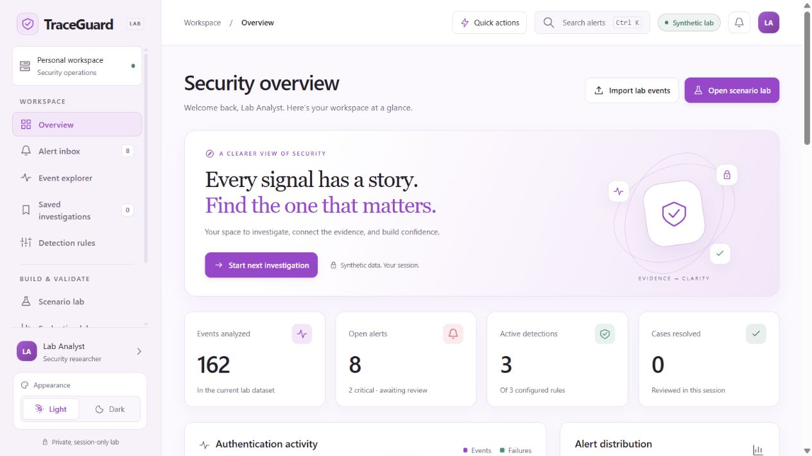

# TraceGuard

A privacy-first cybersecurity investigation portfolio lab built by [Sujal K Rao](https://github.com/sujalrao061). TraceGuard uses synthetic identity events to demonstrate transparent detections, evidence-linked briefs, and accountable security decisions without exposing customer data.

**Connect:** [GitHub](https://github.com/sujalrao061) · [LinkedIn](https://www.linkedin.com/in/sujal-rao-709069432)

**Live demo:** [traceguard-kappa.vercel.app](https://traceguard-kappa.vercel.app/)



## Quick start

```sh
python serve.py
```

Open `http://127.0.0.1:4173` to explore the local synthetic lab. See [Local preview](#local-preview) for requirements and safety boundaries.

## Portfolio highlights

- **90-second Owner Tour** — a guided, skippable walkthrough from security overview to launch readiness.
- **Evidence-first investigations** — transparent detection rules, linked events, safe human decisions, and redacted reports.
- **Access Governance and Owner Control Center** — default-deny policy, role boundaries, launch gates, monitoring expectations, and a reversible pilot plan.
- **Privacy by design** — no customer records, credentials, external AI connection, or telemetry in the browser demo.
- **Tested engineering foundation** — JavaScript detection tests plus a separate Python/FastAPI security foundation.

For a concise company-owner review and presentation-ready explanation, see [OWNER_REVIEW.md](OWNER_REVIEW.md). For the full tour script, see [docs/OWNER_TOUR.md](docs/OWNER_TOUR.md).

## What runs today

- Amethyst appearance: a refined charcoal and soft-white interface with an amethyst accent palette, clear severity colors, and a daylight option.
- A local sign-in and role-selection screen for the portfolio walkthrough. It only simulates onboarding into a synthetic workspace; it does not accept, store, or verify passwords, create cookies, or authenticate a real person or company.
- A front-page **Built by Sujal K Rao** card with configurable skills and public GitHub/LinkedIn links.
- Editable session profile with display name, role, bio, four avatar colors, three accent colors, and compact-table preferences.
- Saved-investigation watchlist and a quick workspace activity panel.
- Profile details, preferences, and bookmarks remain in tab memory. They reset on reload and are never included in report exports.

- A responsive browser workspace with overview charts, searchable/filterable alerts, paginated events, evidence timelines, case status, analyst notes, report exports, rule switches, scenario fixtures, evaluations, and a privacy center.
- An owner-ready operating model with a role simulation, Access Governance, Owner Control Center, case workflow, Case Commitment SLA/ownership/feedback demo, Account Containment & Tenant Boundary walkthrough, data-source contracts, launch checklist, Executive Brief, transparent value-planning model, 30-day pilot plan, detection governance registry, and guarded evidence-assistant preview. These are clearly marked as local prototype features, not production access controls or live integrations.
- Three identity detection rules: repeated failures, success after repeated failures, and administrator-role assignment.
- 162 synthetic events producing 8 baseline alerts. No actual attack execution.
- 12 in-app functional evaluations and a broader automated engine/validation suite.
- A separate Python/FastAPI API using in-memory SQLite, bearer authentication, bounded synthetic imports, parameterized queries, minimized read responses, and a disconnected server-side access-control foundation for tenant-scoped approvals, opaque sessions, tamper-evident audit records, and rate limiting.

**The hosted website is a browser-only lab. The Python API is not connected to it. No language model is connected. Investigation briefs are deterministic templates, clearly labeled in the interface. This is not ready for customer data.**

## Owner review and hiring readiness

**Portfolio/interview evidence.** TraceGuard demonstrates product judgment, an evidence-backed security workflow, privacy and tenant-boundary awareness, buyer-focused planning, responsive design, and repeatable automated tests. It is designed to show how a security product should be evaluated before it connects to a real company.

It remains a local prototype. Production gates before customer data are authenticated server-side tenant context, server-enforced roles and authorization, least-privilege connector integrations, encrypted durable storage, tamper-evident audit records, monitoring and backups, reviewed retention and incident procedures, and separately governed EDR/MDM controls for endpoints and USB devices. See [OWNER_REVIEW.md](OWNER_REVIEW.md) for the concise owner assessment and interview pitch.

## Demo sign-in and production access

The sign-in page is a **local synthetic onboarding and role simulation** for presenting the workflow. It exists so a professor, recruiter, or owner can view the experience from different roles without entering a password. It does not create a real account, authenticate a person, remember a session with cookies, or grant access to customer data.

For a real organization, TraceGuard should begin **default-deny**: nobody can enter a company's workspace until the organization owner or a delegated administrator provisions that person's named account through the company's identity provider. A small pilot can start with just two roles—**Organization Owner** and **Lab Assistant**—while all other employees remain denied until they are explicitly assigned an approved role. There must be no shared owner account, browser-only role picker, or "admin" switch that an employee can change for themselves.

Production access should use the company's established identity provider through SSO with OIDC or SAML. Prefer phishing-resistant passkeys/WebAuthn; allow an authenticator-app TOTP code when necessary. A phone/SMS code can be a tightly controlled recovery method, but it must never be the only proof of identity because phone numbers can be taken over. Wi-Fi or network presence is also not an identity factor; a company network restriction may reduce risk, but it cannot replace sign-in and MFA.

The application server must verify the identity-provider token, derive the company/tenant and role from trusted claims, and enforce them for every request, export, audit record, and connector action. It should issue short-lived server-side sessions, limit or review device sessions, require fresh MFA for sensitive actions, support immediate IdP-led session revocation, and keep durable login, logout, failed-login, role-change, and revocation records. Login, logout, session revocation, suspicious-access monitoring, and audit events must be reviewed controls—not browser-only screens.

For the real Microsoft Entra or Okta configuration, server callback rules, tenant/role mapping, MFA policy, session revocation, and staging checks, see [the production SSO deployment guide](docs/PRODUCTION_SSO.md). [`.env.example`](.env.example) is deliberately a non-secret configuration blueprint for a future server deployment; the local lab does not read it and it does not enable SSO.

For the accompanying operational controls—durable audit design, monitoring, rate limits, backups, recovery, and staged launch ownership—see [the production operations runbook](docs/PRODUCTION_OPERATIONS.md).

For a company-owner view of rollout evidence, launch approval, secure notification expectations, and the first pilot, see [the Owner acceptance checklist](docs/OWNER_ACCEPTANCE.md).

For the presenter-friendly walkthrough that ties the product story together, see [the 90-second Owner Tour script](docs/OWNER_TOUR.md).

## Account containment and tenant boundaries

A suspicious successful sign-in is an investigation signal, not proof that an account was compromised. The production workflow this prototype demonstrates is:

1. Detect the signal and show the linked identity evidence.
2. Verify confidence, business impact, and the affected company's tenant context.
3. Apply an organization-approved containment policy, with a human approval step unless a narrowly reviewed emergency playbook allows automation.
4. Ask the identity provider to revoke sessions and require a recovery or password-reset flow; record the decision, actor, time, and recovery status.
5. Use a separate endpoint-management control for device isolation or USB restrictions when endpoint evidence requires it.

TraceGuard must never receive, store, or directly set an employee password. In a real deployment, session revocation, forced password reset, MFA recovery, and account disablement belong to a least-privilege identity-provider integration. USB device control, endpoint isolation, disk protection, and lab-device policy belong to EDR, MDM, or operating-system controls. TraceGuard can correlate the evidence and document the decision, but those controls must be enforced by the systems that own them.

Each company also needs a server-enforced tenant boundary: tenant identity must come from authenticated server-side context; every query, export, case, audit record, and connector call must be scoped to that tenant; and cross-tenant access must be tested as an adversarial failure case. A company must never be able to select another company's tenant in the interface and see its accounts or investigations.

The current walkthrough is a local, synthetic demonstration only. It does **not** terminate sessions, change passwords, disable accounts, send notifications, block USB devices, isolate endpoints, connect to an identity provider, or create real tenant access boundaries.

The first version uses dependency-free JavaScript, HTML, and CSS rather than the proposed React/TypeScript stack, and SQLite rather than PostgreSQL. This keeps the synthetic demo independently runnable and avoids adding a live data boundary before authentication and tenancy are designed. A future migration should retain the detection contract and regression tests.

## Local preview

From this directory with Python 3.12+:

```sh
python serve.py
```

Open `http://127.0.0.1:4173`. The server exposes only `dist/`, binds loopback, disables directory listing, and adds security headers. It is a development preview, not a production server.

## Run tests

Node 20+:

```sh
node --test tests/engine.test.mjs
```

Python core tests need no third-party dependencies:

```sh
python -m unittest backend.test_core -v
```

For API tests, create an isolated environment, then:

```sh
python -m pip install -r backend/requirements-lock.txt
python -m unittest backend.test_core backend.test_api -v
```

## Optional local API

Set `TRACEGUARD_LAB_TOKEN` to a securely generated random value of at least 32 characters in your local process environment. Never commit or paste the token into the website. Then:

```sh
python -m backend.api
```

It binds only `127.0.0.1:8000`. Every endpoint requires `Authorization: Bearer <token>`. Browser Origin requests are rejected; no CORS access is enabled. Do not expose this lab server publicly.

| Endpoint | Behavior |
|---|---|
| `GET /api/health` | Reports lab mode and disconnected AI |
| `GET /api/system-health` | Authenticated, aggregate-only owner launch-gate view; always activation-gated and never a live-service claim |
| `GET /api/production-readiness` | Authenticated server-side access-control foundation status with no tenant, identity, session, or secret records |
| `POST /api/events` | Replaces events after validating the entire synthetic dataset |
| `GET /api/events?account=demo-alex` | Lists events, excluding IP fields |
| `GET /api/alerts` | Runs the Python detector over SQL records |
| `DELETE /api/events` | Clears the in-memory synthetic dataset |

Use `backend/fixtures.json` as sample input. The synthetic event records disappear when the API exits. The API now includes a disconnected access-control foundation: it can test tenant-scoped approvals, opaque sessions, audit-chain integrity, and an in-process peer-address rate limit, but it has no authenticated user, live SSO connection, customer tenant, distributed limiter, encrypted production database, monitoring service, or backup operation. Keep this API confined to your development machine.

## Demo script

1. Open Scenario lab and load the account takeover pattern.
2. Open its critical alert and inspect the failed and successful login evidence.
3. Generate the brief. Explain why a successful login does not prove compromise.
4. Add a synthetic observation and resolve the case.
5. Export a report: notes are omitted and source addresses removed.
6. Run Evaluation lab. Explain the time window, thresholds, and negative tests.
7. Show Privacy & security and identify the remaining production requirements.

## Data contract

An import is an array of 1–2,000 events, at most 1 MB in the UI/API. All fields are required, all values are strings, unknown fields are rejected, and IDs must be unique. `type` is one of `login_failed`, `login_success`, `role_changed`, `session_ended`; `role` is `user` or `admin`; `source` is `identity-lab`. Account names must match `demo-[a-z0-9-]{1,24}`. IPs must be in the documentation ranges 192.0.2.0/24, 198.51.100.0/24, or 203.0.113.0/24. Dates are valid UTC timestamps in 2026. This contract reduces accidental import of real records; it cannot prove that arbitrary user-provided content is non-sensitive.

## Architecture

```text
Hosted lab: fixture/file -> schema validation -> browser memory -> rules -> evidence brief
                                                             -> interface / redacted download

Separate local API: bearer auth + rate limit -> size/schema validation -> in-memory SQLite -> Python rules
Disconnected access foundation: validated SSO adapter (future) -> tenant/role approval -> opaque session -> protected audit chain
```

There is no connection between these two runtimes, no model call, no telemetry, and no application database in the hosted demo. The host may retain standard access logs.

See [SECURITY.md](SECURITY.md) for the threat model and [ROADMAP.md](ROADMAP.md) for the production/AI milestones.
